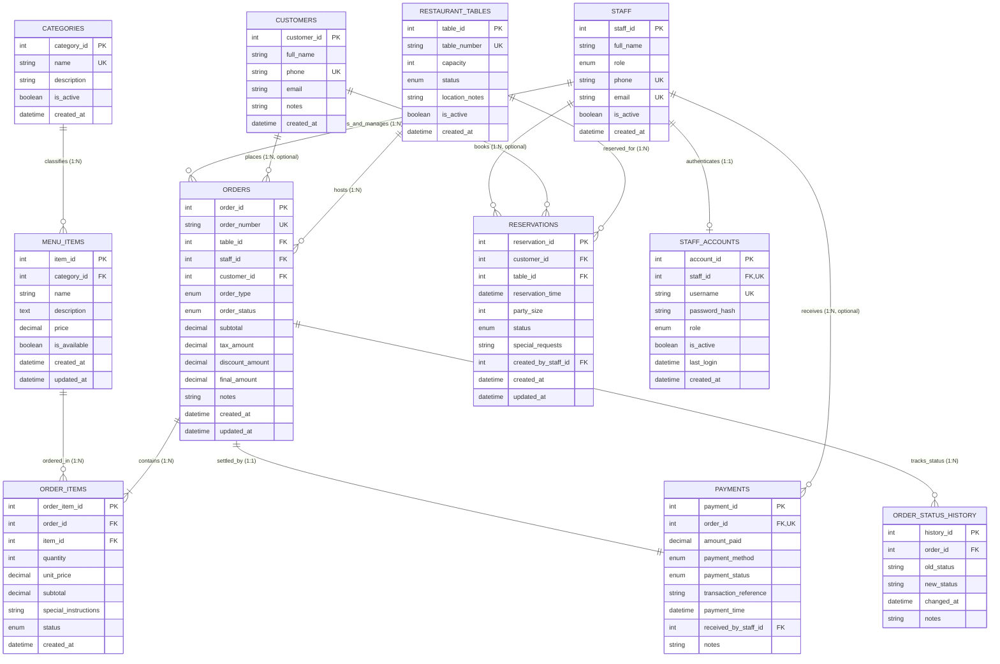

# Entity-Relationship Diagram (ERD) & Relational Model

## Project: Restaurant Table & Order Management System
**Course:** Database Management System (DBMS)  
**Group Members:**
- Muhammad Huzaifa (EB25210006062)
- Muhammad Talha Imran (EB25210006073)
- Muhammad Hammad (EB25210006056)
- Abuzar (EB25210006010)

---

## 1. Relational Entity-Relationship Diagram (Mermaid)

The following diagram represents the implemented MySQL relational schema in `restaurant_db`.

---

## 2. Entity Relationships and Cardinality Matrix

| Relationship | Cardinality | Foreign Key | Referential Action (ON DELETE) | Business Rule Enforced |
| :--- | :--- | :--- | :--- | :--- |
| `categories` &rarr; `menu_items` | **1 : N** | `menu_items.category_id` | `RESTRICT` | A category cannot be deleted if active menu items exist under it. |
| `restaurant_tables` &rarr; `orders` | **1 : N** | `orders.table_id` | `RESTRICT` | Table records with historical orders cannot be dropped; soft deactivation is used. |
| `restaurant_tables` &rarr; `reservations` | **1 : N** | `reservations.table_id` | `RESTRICT` | Preserves reservation history for all dining tables. |
| `customers` &rarr; `reservations` | **1 : N** | `reservations.customer_id` | `RESTRICT` | Reservations require a valid customer record. |
| `customers` &rarr; `orders` | **1 : N** | `orders.customer_id` | `SET NULL` | Nullable foreign key: supports walk-in customers without forcing registration. |
| `staff` &rarr; `orders` | **1 : N** | `orders.staff_id` | `RESTRICT` | Every order is accountable to an active staff member. |
| `staff` &rarr; `staff_accounts` | **1 : 1** | `staff_accounts.staff_id` | `CASCADE` | Unique constraint enforces strictly 1 system login account per employee. |
| `orders` &rarr; `order_items` | **1 : N** | `order_items.order_id` | `CASCADE` | When an order is deleted, its individual line items are removed. |
| `menu_items` &rarr; `order_items` | **1 : N** | `order_items.item_id` | `RESTRICT` | Historical order items cannot be deleted if a menu item is removed. Unit price is frozen. |
| `orders` &rarr; `payments` | **1 : 1** | `payments.order_id` | `RESTRICT` | **UNIQUE(order_id)** strictly guarantees that each order has exactly one payment record. |
| `orders` &rarr; `order_status_history` | **1 : N** | `order_status_history.order_id` | `CASCADE` | Populated automatically by database trigger `trg_order_status_audit`. |

---

## 3. Referential Actions & Integrity Justifications

1. **Strict 1-to-1 Order-to-Payment Cardinality**:
   The proposal explicitly specifies a one-to-one relationship between orders and payments. In MySQL, this is enforced by placing a `UNIQUE` constraint on `payments.order_id`. Any attempt to insert a second payment for the same order raises constraint error `ER_DUP_ENTRY`.

2. **Price Freezing in `order_items`**:
   The column `order_items.unit_price` stores the price of the item at the exact moment of order placement. If an administrator later updates `menu_items.price` in the menu catalog, historical bills, daily sales reports, and customer receipts remain mathematically unchanged.

3. **Walk-In Dine-In & Takeaway Support**:
   Foreign keys `orders.customer_id` and `orders.table_id` are deliberately nullable:
   - For takeaway orders, `table_id` is `NULL`.
   - For walk-in customers who do not provide their contact details, `customer_id` is `NULL`.
